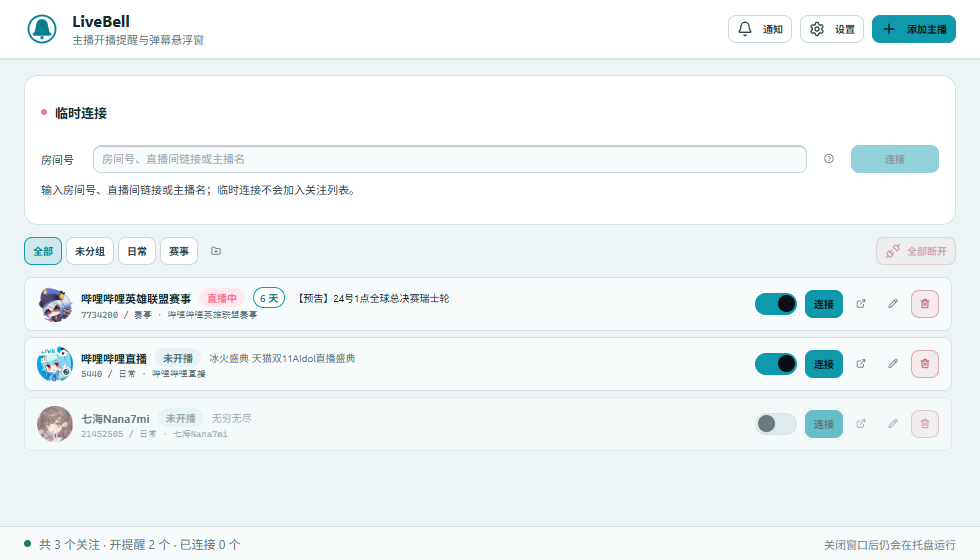
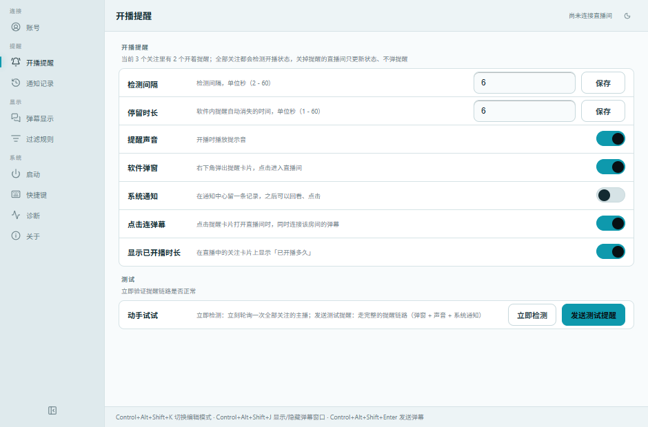

<p align="center">
  <picture>
    <source media="(prefers-color-scheme: dark)" srcset="docs/images/logo-dark.png">
    
  </picture>
</p>

<h1 align="center">LiveBell</h1>

<p align="center">关注的主播一开播就提醒你，同时把直播间弹幕铺在屏幕上。</p>

<p align="center">
  
  
  
</p>

<p align="center"><a href="https://github.com/kyaru-ID/LiveBell/releases/latest"><b>下载最新版本 →</b></a></p>



---

## 这是什么

LiveBell 只做两件事，都围绕「看 B 站直播」：

1. **盯开播** —— 关注的主播一开播就提醒你：右下角弹窗、Windows 系统通知、软件内通知记录，三条通道。
2. **看弹幕** —— 一套内置的弹幕窗，可以铺在屏幕任意位置、平时鼠标穿透，支持多房间、关键词过滤、直接发弹幕。

---

## 功能

### 关注列表与分组

- **多标签分组**：一个主播可以同时属于多个分组（不是只能归一个组）
- **空组可保留**：可以先把组建好，之后再往里放人
- 列表上方一排分组页签（**全部 / 未分组 / 自定义组**，带数量），点一下只看该组
- **拖拽**：
  - 拖主播到分组页签 → 加入该组；拖到「未分组」→ 移出所有组
  - 列表内上下拖 → 调整主播顺序
  - 页签互拖 → 调整分组顺序
- 「•••」编辑主播时可**多选**所属分组；删除分组只摘归属关系，**不会移除任何主播**
- 每行一个「开播提醒」开关：**关掉只是不提醒**，开播状态照样检测并在卡片上显示（该行会稍微变淡），也能临时连接 / 进直播间 / 编辑 / 删除
- 直播中的卡片直接显示**已开播多久**（如「1 小时 23 分」，每分钟自动刷新），可在设置里关掉
- 头像由后端下载到本地缓存，离线也显示得出来

### 临时连接（不加入关注列表也能连）

想看一眼某个直播间的弹幕，不必先把它加进关注列表。主窗口顶部就是常驻的**临时连接**区块：

- 支持三种输入：**房间号**、**直播间链接**、**直接搜主播名**（搜到点一下就连）
- 输入房间号后会显示「房间 X · 直播中/未开播 · 标题」
- 临时连接**不写进关注列表**：不监听开播、不发提醒；用完可以直接「断开」
- **可以同时连多个房间**（含关注列表里的房间，上限 5 个），互不干扰

### 开播提醒

| 能力 | 说明 |
|---|---|
| 右下角弹窗 | 头像、标题，点击直接进直播间；颜色 / 尺寸 / 停留时长 / 提示音都能调 |
| Windows 系统通知 | 真 · Toast，会留在系统通知中心 |
| 软件内通知记录 | 未读 / 已读、已读可折叠、逐条标记已读；**从新到旧**排列（带头像） |
| 弹窗的已读规则 | 点击弹窗或点 × 关闭 → 自动已读；只有**超时自动消失**才保持未读 |
| 点弹窗的联动 | 点弹窗进直播间时，可以顺便把该房间的弹幕窗也连上（可关） |
| 两种通知独立开关 | 系统通知（Toast）与软件内弹窗可以分别关掉 |
| 已开播时长 | 关注卡片上显示这一场直播已经播了多久（数据来自 B 站开播时间，取不到时用本地首次检测时间） |

### 弹幕窗

- **显隐**：全局热键（默认 `Ctrl+Alt+J`），托盘菜单也能开
- **编辑模式**：`Ctrl+Alt+K`，拖动移动、拖右下角改大小，底部有悬浮控制坞
- **不挡操作**：平时鼠标**穿透**；只有编辑模式才接管鼠标
- **不出现在 Alt+Tab**：它是覆盖层，标了 `WS_EX_TOOLWINDOW`
- **可调外观**：字号 / 表情大小 / 透明度 / 滚动速度 / 显示密度 / 是否显示用户名 / 同接数徽章
  - 「表情大小」**只作用于直播间 / 收藏集的大表情**；B 站默认小表情（`[dog]`、`[藏狐]` 这类「黄豆表情」）始终**与文字同高**，跟着字号走
- **实时预览**：在设置里拖滑块，弹幕窗**立刻**跟着变，不用保存
- **窗口位置与大小会记住**，下次启动回到原处
- **同接数徽章**：右上角显示当前在线人数，多房间时每个房间一个（带来源色点）
- 另有**历史抽屉**与**统计抽屉**：看最近弹幕、看各环节计数与过滤原因分布

### 弹幕过滤

| 部分 | 说明 |
|---|---|
| **屏蔽词** | 每行一个词，正文包含任意一个就隐藏，**优先级最高** |
| **规则** | 作用对象（正文 / 用户名 / UID / 粉丝牌）× 匹配方式（包含 / 等于 / 开头是 / 结尾是 / 正则）× 动作（隐藏 / 高亮） |

### 发送弹幕

- 全局热键唤起（默认 `Ctrl+Alt+Enter`），Enter 发送、Esc 关闭
- 目标房间是一个下拉框：关注列表和已连接的临时房间都在里面，**自动选中唯一可用的房间**
- 按 **Unicode 码点**计数（emoji 算 1 个字，上限 20），避免「看着没超却被拒」
- 本地 3 秒节流；登录态失效会自动降级并提示重新登录

### 弹幕录制

- 设置里一键开启，弹幕按房间写进 `Data/danmaku-records/`（每个房间一个文件）
- 最多同时录制 5 个房间；设置页能看到当前正在写的文件

### 系统集成

- **单实例**：再启动一次不会开出第二个程序，而是把已有窗口唤到前面
- **托盘常驻**：关掉窗口后仍在托盘运行，菜单里能直接连接房间、发弹幕、开关弹幕窗、打开设置
- **开机自启**：写 `HKCU\...\CurrentVersion\Run`，可选静默后台启动（`--background`）
- **便携模式**：数据全放在程序目录的 `Data/`，不写 `%APPDATA%`
- **更新**：下载新版本的 zip，**覆盖同一个目录**即可——数据都在旁边的 `Data/` 里，覆盖程序不会丢
  - 「关于」页的「启动时检查更新」默认关闭；自动更新目前还没启用，请手动到 [Releases](https://github.com/kyaru-ID/LiveBell/releases/latest) 下载

### 运维与调试

- **诊断页**：运行信息、弹幕链路计数（含过滤原因分布）、日志尾部、导出诊断包
- **Mock 弹幕面板**：不连直播间也能灌假弹幕（约 18% 带表情），用来验证渲染与过滤规则
- **扫码登录**：设置 → 账号，B 站 App 扫码即可

---

## 截图

| 主界面 | 弹幕窗 |
|---|---|
|  |  |

| 通知弹窗 | 设置 |
|---|---|
|  |  |

---

## 快速开始

1. 到 [Releases](https://github.com/kyaru-ID/LiveBell/releases/latest) 下载最新的 `LiveBell-v*-portable.zip`
2. 解压到一个**单独的文件夹**（不建议放桌面或「下载」目录，那里文件太杂）
3. 双击 `LiveBell.exe`
4. 点右上角「＋ 添加主播」，填房间号、直播间链接或主播名都行
5. 想收 Windows 系统通知的话，到设置里打开「开机自启动」，关窗口会缩到托盘继续监听

要调设置：主窗口右上「设置」，或者托盘右键菜单。

## 系统要求

- Windows 10 1809 及以上 / Windows 11
- **WebView2 运行时**（Win11 与较新的 Win10 已内置）

## 常见问题

**需要安装吗？要管理员权限吗？**
不需要安装，也不用管理员权限，解压即用。数据都在程序目录的 `Data/` 里，不写 `%APPDATA%`；
注册表只在两处动过：开「开机自启」时写的一条 `HKCU\...\Run`，以及系统通知需要的 `AppUserModelId` 项。

**为什么 Windows 提示「已保护你的电脑」？**
`exe` 没有代码签名证书，SmartScreen 对无签名的新程序都会这样提示。点「更多信息 → 仍要运行」即可。

**收开播提醒需要登录 B 站吗？**
不需要。只有**发弹幕**必须登录（设置 → 账号扫码），未登录时会提示「请先登录 B 站」。

**能同时连几个直播间？**
最多 5 个，可以混着关注列表里的房间和临时连接。

**换电脑怎么搬？**
把整个程序文件夹（含 `Data/`）拷过去就行。登录态存在 Windows 凭据管理器里，不跟着文件夹走，
新机器上重新扫码登录一次即可。

**关掉窗口程序就退出了吗？**
没有，是缩到托盘继续在后台跑。要彻底退出用托盘右键菜单。

## 构建

需要 [Node.js](https://nodejs.org/)（20+）、[Rust](https://rustup.rs/)（MSVC 工具链）和 WebView2。

```powershell
# 前端依赖
npm install

# 开发（Vite 前端 + Tauri 窗口一起起）
npm run tauri dev

# 发布构建
npm run build                                        # 前端 → dist/
cd src-tauri
cargo build --release --features custom-protocol     # 后端 → target\release\livebell.exe
```

## 项目结构

```
src/                        前端（React 19 + TypeScript + Tailwind）
  components/               主窗口、设置、弹幕层、编辑工作区、通知窗、发送弹幕窗
    ui/                     通用组件（按钮、开关、AppLogo 等）
  hooks/                    弹幕运行时、房间会话、外观配置
  utils/                    纯函数（时长格式化、时间等）
  data/mockDanmaku.ts       Mock 弹幕消息源
  preview/                  浏览器里的界面预览（mock IPC，不启动 Tauri）
public/                     静态资源（界面 logo 蒙版、站点图标）
src-tauri/                  后端（Rust）
  src/bilibili/             弹幕协议 / 连接与会话管理 / 发送 / 过滤 / 头像缓存 / 录制
  src/window_control/       各窗口、布局记忆、全局快捷键、编辑模式与鼠标穿透
  src/live_monitor.rs       开播轮询
  src/notifications.rs      通知历史与待展示队列
  src/toast.rs              Windows 原生 Toast（AUMID + 开始菜单快捷方式）
  src/tray.rs               托盘
  src/portable.rs           便携数据目录（exe 旁 Data/）
  src/legacy_migration.rs   从旧版 EiheiLing 迁移数据 / 登录态 / 开机自启
scripts/                    数据迁移与自检脚本
docs/                       文档与截图
```

## 测试

```powershell
npm run test:ui                    # 前端：Vitest（62 个文件 / 497 个用例）
npm run test:danmaku-runtime       # 弹幕运行时分派与短路
npm run test:tauri-capability      # 窗口能力（capabilities）自检
npm run test:updater-script        # 更新脚本自检

cd src-tauri; cargo test           # 后端：协议解析、过滤、房间管理、快捷键等
```

## 数据与隐私

- 所有数据都在程序目录的 `Data/`：`app-config.json`（设置）、`notifications.json`（通知记录，最多 200 条）、
  `Avatars/`（头像缓存）、`danmaku-records/`（弹幕录制）、`logs/`
- **B 站登录 Cookie 存在 Windows 凭据管理器**里（`CredWrite`，条目名
  `bilibili-cookie-bundle.com.kyaru.livebell.bilibili.auth`），**不落盘到 `Data/`**
  —— 所以整个 `Data/` 目录可以随便备份或删掉，不会泄露登录态
- 除了访问 B 站自己的接口（房间状态、弹幕流、登录、发送弹幕），程序不向任何第三方发送数据

---

## 致谢

- 弹幕渲染思路与过滤规则语义参考了 [Drift](https://github.com/proudzhao/Drift)（B 站直播弹幕客户端）
- LiveBell 的起点是 [EheRing](https://github.com/ibukidvko/EheRing)（B 站开播提醒，C# 便携版）
- [Tauri](https://tauri.app/)、[React](https://react.dev/)、[Tailwind CSS](https://tailwindcss.com/)
